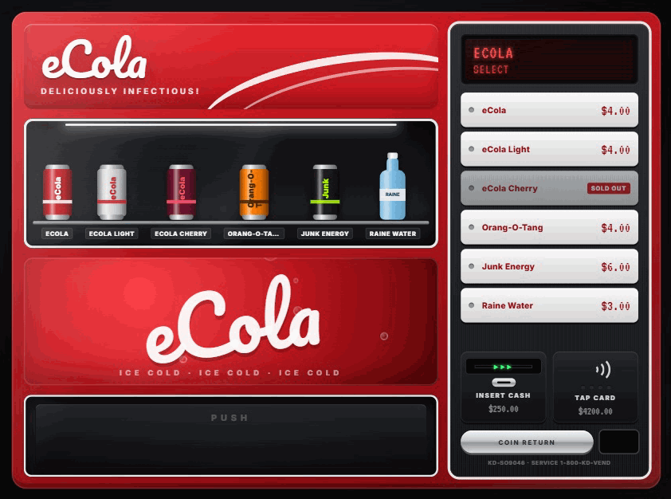

<div align="center">

# 🥤 Komadev.dk - Vendingmachine

**Immersive, themed vending machines for FiveM. Every machine gets its own realistic interface.**

Walk up, press the buttons, pay with cash or card, watch your can drop, then reach into the tray and grab it.




<sub>The eCola machine. Snacks, coffee, water, Sprunk and the retro cigarette machine each have their own interface.</sub>

</div>

---

## ✨ Features

- **A unique UI for every machine type.** It isn't one menu with a different colour:
  | Machine | Prop(s) | Interface |
  |---|---|---|
  | **eCola** | `prop_vend_soda_01` | Red soda front, lit sample window, selection buttons, bill acceptor + contactless reader |
  | **Sprunk** | `prop_vend_soda_02` | Same hardware, Sprunk lime branding |
  | **Raine** | `prop_vend_water_01` | Clean glacier-blue water machine |
  | **Snacks** | `prop_vend_snak_01`, `prop_vend_snak_01_tu` | Glass-front machine with spiral coils, shelf tags and an **A1–D6 keypad** (you can also type on your keyboard) |
  | **Coffee** | `prop_vend_coffe_01` | **Touchscreen**: drink, cup size (changes price), sugar and strength, a brewing progress ring, a cup bay with a pour animation and steam |
  | **Cigarettes** | `prop_vend_fags_01` | **70s pull-knob machine**: wood grain, chase-light marquee, insert coins, then pull a chrome knob |
- **Physical animations:**
  - the player walks up to the machine and turns to face it
  - pressing-buttons idle while the UI is open
  - a confirm press when you pay
  - **reaching down into the tray and grabbing the product**, with the real prop (can, bottle, chocolate bar, chips, coffee cup, cigarette pack) in hand, visible to other players
- **Machine feedback:** LCD/VFD displays, card reader LEDs, a bill sliding into the acceptor, the coil spinning, the product dropping and bouncing in the tray, and a flap you push to take it
- **Procedural sound effects** (Web Audio): key beeps, coins, card approval, motor hum, the thunk of the drop, brewing and knob ratchets. No audio files are shipped.
- **Framework agnostic:** QBox, QBCore, ESX, or standalone with ox_inventory. Detected automatically.
- **Works with whatever you have for interaction:** ox_target → qb-target → ox_lib text UI → native GTA help text (`~INPUT_CONTEXT~`)
- **Server authoritative:** prices, stock, distance, payment methods, carry checks and cooldowns are all validated server-side. If the item can't be added, the money is refunded automatically.
- **Per-machine stock** with automatic restocking, and an admin `/restockvending` command
- **Discord webhook logging** for purchases and suspicious requests
- **Extra placements:** spawn additional machines anywhere from the config
- **Locales:** English and Danish included
- **Dev preview:** open `web/index.html` in your browser to click through every machine without starting the game
- Zero required dependencies. ~0.00 ms idle with target systems.

---

## 📦 Requirements

| | |
|---|---|
| **Framework** (one of) | [qbx_core](https://github.com/Qbox-project/qbx_core) · [qb-core](https://github.com/qbcore-framework/qb-core) · [es_extended](https://github.com/esx-framework/esx_core) · *or* standalone with ox_inventory |
| **Inventory** | [ox_inventory](https://github.com/overextended/ox_inventory), qb-inventory (and forks), or ESX default |
| **Optional** | [ox_target](https://github.com/overextended/ox_target) / [qb-target](https://github.com/qbcore-framework/qb-target), [ox_lib](https://github.com/overextended/ox_lib) (notifications & text UI) |
| **Server** | OneSync enabled (used for server-side distance checks) |

---

## 🚀 Installation

1. **Download** the [latest release](../../releases/latest) and extract it.
2. Rename the folder to `kd-vendingmachine` if needed and drop it into your `resources` folder.
3. **Add the items** to your inventory (see [Items](#-items) below).
4. Add to your `server.cfg` **after** your framework, inventory and target:
   ```cfg
   ensure kd-vendingmachine
   ```
5. *(Optional)* give admins the restock permission:
   ```cfg
   add_ace group.admin kdvending.admin allow
   ```
6. Restart your server. The console should print:
   ```
   [kd-vendingmachine] v1.0.0 loaded · framework: qbox · inventory: ox_inventory
   ```
   Any item that is missing from your inventory is listed in a warning on startup.

---

## 🍫 Items

The default config sells ~30 items. Ready-to-paste definitions are in [`/install`](install):

| Inventory | File | Where it goes |
|---|---|---|
| **ox_inventory** (QBox / ESX / standalone) | [`install/ox_inventory.lua`](install/ox_inventory.lua) | `ox_inventory/data/items.lua`. Includes consume anims, props and status values. |
| **qb-inventory** | [`install/qb-core.lua`](install/qb-core.lua) | `qb-core/shared/items.lua` |
| **ESX default inventory** | [`install/esx.sql`](install/esx.sql) | Run against your database |

> [!TIP]
> Already have `water`, `coffee`, `sandwich` or `lighter`? Skip those. You can also change any machine to sell your existing items. Just edit the `name` field in the config.

---

## ⚙️ Configuration

There are two config files:

| File | Contents | Sent to clients? |
|---|---|---|
| [`config/config.lua`](config/config.lua) | Machines, items, prices, UI, animations, interaction | Yes |
| [`config/server.lua`](config/server.lua) | Webhook, max distance, admin ace, logging | **No** |

### General

```lua
Config.Locale      = 'en'     -- 'en' | 'da'
Config.Framework   = 'auto'   -- 'auto' | 'qbox' | 'qbcore' | 'esx' | 'standalone'
Config.Inventory   = 'auto'   -- 'auto' | 'ox_inventory' | 'framework'
Config.Interaction = 'auto'   -- 'auto' | 'ox_target' | 'qb-target' | 'textui' | 'native'
Config.Notify      = 'auto'   -- 'auto' | 'ox_lib' | 'framework' | 'native'

Config.InteractDistance = 1.6
Config.AlignPlayer      = true   -- walk up to the machine before the UI opens
Config.NetworkedProps   = true   -- others can see the product in your hand
Config.Cooldown         = 1500   -- ms between purchases (server enforced)
```

### Payment & stock

```lua
Config.Payment = { cash = true, bank = true }   -- default, override per machine

Config.Stock = {
    enabled        = true,
    default        = 12,   -- per slot, override with `stock = n` on an item
    restockMinutes = 30,
}
```

Stock is tracked **per physical machine**: two eCola machines side by side each have their own stock.

### Interface

```lua
Config.UI = {
    currency    = '$',
    sound       = true,
    volume      = 0.35,
    showBalance = true,      -- show cash / bank under the payment modules
    autoTake    = 8000,      -- auto-grab after X ms if the player doesn't click the tray (0 = off)
    images      = 'drawn',   -- 'drawn' | 'inventory' | 'nui://my-images/%s.png'
}
```

| `images` | Result |
|---|---|
| `'drawn'` | Stylised CSS products (cans, bottles, bars, chips, cups, packs) coloured per item. Works with zero setup and matches the machine art. |
| `'inventory'` | Uses your inventory's item images (ox / qb / ps / lj inventory auto-detected). Falls back to drawn if an image is missing. |
| custom string | Any URL template containing `%s` (replaced with the item name) |

### Adding or editing a machine

```lua
Config.Machines.mymachine = {
    label     = 'Energy Machine',          -- target label / notifications
    brand     = 'Junk',                    -- printed on the machine
    tagline   = 'The quick fix',
    layout    = 'soda',                    -- 'soda' | 'glass' | 'coffee' | 'retro'
    theme     = 'sprunk',                  -- 'ecola' | 'sprunk' | 'raine' | 'snack' | 'coffee' | 'redwood'
    models    = { 'prop_vend_soda_02' },   -- each model can only belong to one machine
    animation = 'tray_low',                -- key from Config.Animations
    icon      = 'fa-solid fa-bolt',
    payment   = { cash = true, bank = false },   -- optional
    items = {
        {
            name   = 'junk_energy',  -- inventory item
            label  = 'Junk Energy',
            price  = 6,
            kind   = 'can',          -- drawn shape: can | bottle | bar | bag | candy | cup | pack
            color  = '#1b1b1b',      -- main colour
            accent = '#b6ff00',      -- label / stripe colour
            prop   = 'can',          -- hand prop, key from Config.Props
            stock  = 20,             -- optional
            -- image    = 'https://...',          -- optional, overrides Config.UI.images
            -- metadata = { quality = 100 },      -- optional, ox_inventory metadata
        },
    },
}
```

Coffee-style machines can have **sizes** that multiply the price (validated server-side):

```lua
sizes = {
    { label = 'S', name = 'Small',  multiplier = 1.0 },
    { label = 'M', name = 'Medium', multiplier = 1.25 },
    { label = 'L', name = 'Large',  multiplier = 1.5 },
},
```

### Animations

Every machine uses an animation preset. You can tweak them or add your own:

```lua
Config.Animations.tray_low = {
    align  = vec3(0.0, -0.78, 0.0),   -- where the player stands (machines face -Y)
    browse = { dict = 'anim@heists@keypad@', clip = 'idle_a', flag = 49 },        -- loop while UI is open
    press  = { dict = 'anim@heists@keypad@', clip = 'exit',   flag = 48 },        -- confirm purchase
    grab   = { dict = 'pickup_object', clip = 'pickup_low', flag = 0,
               propAt = 0.36,   -- anim phase where the product appears in the hand
               stopAt = 0.92,   -- anim phase where the grab ends
               hold   = 900 },  -- ms the product stays in hand afterwards
}
```

Hand props live in `Config.Props` and are referenced by name from items (`prop = 'ecola'`). Invalid models are skipped with a console warning, so nothing breaks.

### Extra placements

```lua
Config.Placements = {
    { machine = 'coffee', coords = vec4(-1199.61, -884.82, 12.81, 124.0) },
    { machine = 'snacks', coords = vec4(441.32, -979.64, 29.69, 180.0), model = 'prop_vend_snak_01_tu' },
}
```

---

## 🔌 API

### Client exports

```lua
-- Open the UI for a machine entity (e.g. from your own target / interaction script)
exports['kd-vendingmachine']:OpenMachine(entity)

-- Is the UI currently open?
local open = exports['kd-vendingmachine']:IsOpen()

-- Force close (the player still grabs anything they paid for)
exports['kd-vendingmachine']:CloseMachine()
```

### Server exports

```lua
-- Refill every machine
exports['kd-vendingmachine']:Restock()

-- Current stock of a specific machine
local stock = exports['kd-vendingmachine']:GetStock('ecola', vec3(x, y, z))
```

### Server events

```lua
-- Fired after every successful purchase
AddEventHandler('kd-vendingmachine:purchased', function(source, data)
    -- data.machine, data.item, data.price, data.payment, data.coords
end)
```

### Commands

| Command | Permission | Description |
|---|---|---|
| `/restockvending` | `kdvending.admin` (or server console) | Refill every machine |

---

## 🛡️ Security

The client never decides anything that matters. For every purchase the server:

- checks the player is within `ServerConfig.MaxDistance` of the machine
- verifies the item belongs to that machine and takes the price **from the config**, never from the client
- validates the payment method and cup size
- checks stock, inventory space and balance
- removes the money first, then adds the item, and **refunds** if adding the item fails
- enforces a per-player cooldown
- logs anything suspicious to the console and, optionally, a Discord webhook

---

## 🧪 Development

Open `web/index.html` directly in Chrome or Edge. A toolbar appears at the top where you can open every machine with mock data, a mock balance and some sold-out items. It's useful for theming without restarting your server.

```
kd-vendingmachine/
├── bridge/          framework abstraction (client + server)
├── client/          interaction, animation, placements, main flow
├── config/          config.lua (shared) · server.lua (server only)
├── docs/images/     README preview GIF (not loaded by the game)
├── install/         item definitions for each inventory
├── locales/         en, da
├── server/          purchase validation, stock
├── shared/          utils, RPC, locale helper
└── web/             NUI (vanilla JS/CSS, no build step)
    ├── css/style.css
    └── js/  app.js · layouts.js · products.js · sound.js
```

Want a new language? Copy `locales/en.lua` to `locales/xx.lua`, change `Locales['en']` to `Locales['xx']`, translate it, and set `Config.Locale = 'xx'`.

---

## ❓ FAQ

<details>
<summary><b>Nothing happens when I target a machine</b></summary>

Make sure `kd-vendingmachine` starts **after** your target resource. With `Config.Debug = true` the F8 console prints which interaction mode was picked.
</details>

<details>
<summary><b>"Not enough money" / "You cannot carry that" even though I can</b></summary>

Check that the item exists in your inventory. Missing items are listed on resource start. Unknown items fail the carry check.
</details>

<details>
<summary><b>The player doesn't line up with the machine</b></summary>

Adjust `align` in the animation preset. `y` is the distance in front of the machine (negative = in front). You can also disable walking up with `Config.AlignPlayer = false`.
</details>

<details>
<summary><b>Can I use my own vending machine props / MLO machines?</b></summary>

Yes. Add the model name to a machine's `models` list, or create a new machine entry. Any prop works.
</details>

<details>
<summary><b>Does the UI work without internet (fonts)?</b></summary>

Fonts load from Google Fonts. Without internet the UI falls back to system fonts and still works.
</details>

---

## 📝 License

[MIT](LICENSE). Use it, modify it, ship it. Credit is appreciated but not required.

<div align="center">
<sub>Made with ☕ by KD Scripts</sub>
</div>
